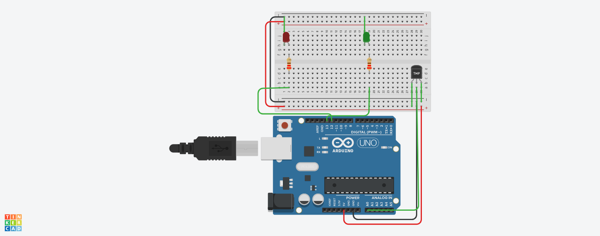

# Automated Temperature Sensor 🌡️

A simple Arduino-based environmental control system that monitors ambient temperature using a TMP36 sensor and activates visual indicators (LEDs) to simulate a heating and cooling system.

## 📖 Overview
This project reads the analog voltage from a TMP36 temperature sensor and converts it into Celsius. Based on the temperature, the system controls two LEDs:
*   **Green LED (Fan):** Turns on when the temperature exceeds 30°C.
*   **Red LED (Heater):** Turns on when the temperature drops below 20°C.
*   Data is also outputted to the Serial Monitor for real-time tracking.

## 🧰 Components
*   1x Arduino Uno R3
*   1x TMP36 Temperature Sensor
*   1x Red LED (Heater)
*   1x Green LED (Fan)
*   2x 220Ω Resistors
*   1x Small Breadboard

## 🔌 Circuit Design
You can view the full files here:
*   [View Circuit Schematic PDF](docs/schematic.pdf)
*   [View Breadboard Layout](docs/breadboard.png)

### Breadboard Preview

## 💻 How It Works
1.  The TMP36 sensor outputs an analog voltage proportional to the temperature.
2.  The Arduino reads this via `Analog Pin A0`.
3.  The raw value (0-1023) is converted to a voltage (0-5V).
4.  The voltage is converted to Celsius using the TMP36 offset (0.5V = 0°C, 10mV/°C).
5.  Logic statements turn on the respective LEDs and print warnings to the Serial Monitor.

## 🚀 How to Run
1.  Open the Arduino IDE.
2.  Open the `src/automated_temperature_sensor.ino` file.
3.  Connect your Arduino Uno via USB.
4.  Select the correct Board and Port in the IDE.
5.  Upload the code.
6.  Open the **Serial Monitor** (set to 9600 baud) to view the temperature.

## 🧪 Simulation
You can view and simulate this project directly on Tinkercad: [ https://www.tinkercad.com/things/1tF61rGOqtn-automated-temperature-sensor ]

## 👨‍💻 Author
**Jesus Aurelio Corpus**

## 📄 License
This project is open-source and available under the [MIT License](LICENSE).
